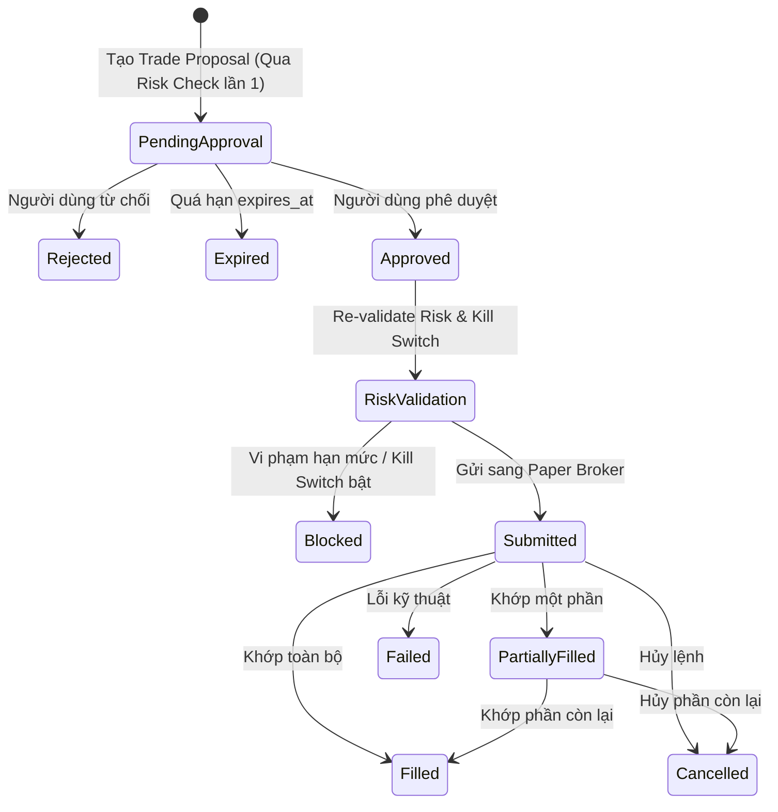
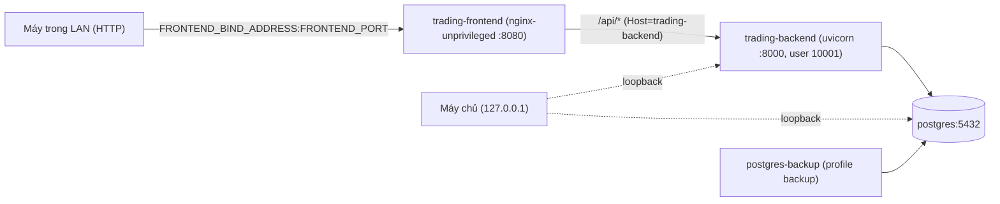

# DESIGN.md — Tài liệu Thiết kế Hệ thống & Giao diện

> **Ngày khởi tạo:** 2026-11-03  
> **Phiên bản:** 1.0 (MVP)  
> **Mục đích:** Mô tả chi tiết kiến trúc kỹ thuật, thiết kế cơ sở dữ liệu (6 schemas), luồng nghiệp vụ giao dịch an toàn và hệ thống thiết kế giao diện (UI/UX Design System) cho **Personal AI Trading Assistant**.

---

## 1. Kiến trúc Tổng thể (System Architecture)

Hệ thống được thiết kế theo mô hình **Python Modular Monolith + Angular Dashboard + PostgreSQL 16**, triển khai gọn nhẹ trong một Monorepo thông qua Docker Compose.

```mermaid
flowchart TD
    subgraph DataSources["Nguồn dữ liệu (EOD)"]
        CSV["CSV Market Data (HOSE/HNX/UPCOM)"]
    end

    subgraph Backend["Python FastAPI Backend (Modular Monolith)"]
        MD["market_data: Validation & CSV Import"]
        IND["indicators: SMA, EMA, RSI, MACD, ATR, VolAvg"]
        STR["strategies & screening: Trend Following / Pullback"]
        BT["backtesting: No Look-Ahead Engine"]
        AI["ai: Explainable JSON Report (Isolated)"]
        RISK["risk: Position Sizing & Mandatory Gate"]
        TRD["trading: Proposals, Human Approval, Paper Broker"]
        PF["portfolio: Ledger & Reconciliation"]
        SYS["system: Audit Logs, Job Runs, Kill Switch"]
    end

    subgraph Database["PostgreSQL 16 (trading_db)"]
        DB_M[("Schema: market")]
        DB_A[("Schema: analysis")]
        DB_S[("Schema: strategy")]
        DB_T[("Schema: trading")]
        DB_P[("Schema: portfolio")]
        DB_SYS[("Schema: system")]
    end

    subgraph Frontend["Angular Dashboard"]
        UI["8 Màn hình Quản trị & Phê duyệt Giao dịch"]
    end

    CSV --> MD
    MD --> DB_M
    DB_M --> IND --> DB_A
    DB_A --> STR --> DB_A
    DB_M & DB_A --> BT --> DB_S
    DB_A --> AI --> DB_A
    DB_A --> RISK --> TRD
    TRD <-->|"Approve / Reject"| UI
    TRD -->|"Paper Execution"| PF
    TRD --> DB_T
    PF --> DB_P
    SYS --> DB_SYS
```

### Lý do lựa chọn kiến trúc:
- **Đồng nhất ngôn ngữ Backend (Python 3.12):** Loại bỏ độ trễ và chi phí duy trì cầu nối HTTP nội bộ giữa hai ngôn ngữ khác nhau, giúp chia sẻ trực tiếp các kiểu dữ liệu `Decimal`, Pydantic schemas và SQLAlchemy session.
- **Cô lập trách nhiệm bằng Module & Database Schema:** Dù nằm trong một codebase Python, dữ liệu được phân tách thành 6 schema PostgreSQL riêng biệt và module `ai` hoàn toàn không có dependency tới `trading` hay `paper_broker`.

---

## 2. Thiết kế Cơ sở Dữ liệu (6 PostgreSQL Schemas — 25 Bảng)

Toàn bộ giá trị tiền tệ và giá cổ phiếu sử dụng kiểu `NUMERIC(18,4)` hoặc `NUMERIC(18,2)`. Tất cả thời điểm sự kiện dùng `TIMESTAMPTZ` (UTC).

### 2.1. Schema `market` (Dữ liệu thị trường)
1. **`market.stocks`**: Danh mục mã cổ phiếu (`id`, `symbol` UNIQUE, `exchange`, `company_name`, `sector`, `is_active`, `created_at`).
2. **`market.data_sources`**: Nguồn cung cấp dữ liệu (`id`, `name`, `provider_type`, `license_notes`, `created_at`).
3. **`market.import_batches`**: Lịch sử lô import (`id`, `source_id`, `file_name`, `checksum`, `started_at`, `completed_at`, `status`, `rows_read`, `rows_inserted`, `rows_rejected`, `error_detail`).
4. **`market.daily_prices`**: Giá OHLCV theo ngày (`id`, `stock_id`, `source_id`, `import_batch_id`, `trading_date`, `open`, `high`, `low`, `close`, `adjusted_close`, `volume`, `created_at`).
   - *Constraints:* Unique `(stock_id, trading_date, source_id)`; `open, high, low, close > 0`; `high >= low`; `high >= open, close`; `low <= open, close`; `volume >= 0`.

### 2.2. Schema `analysis` (Phân tích kỹ thuật & AI)
5. **`analysis.analysis_runs`**: Lịch sử chạy phân tích (`id`, `run_type`, `started_at`, `completed_at`, `status`, `data_as_of`, `parameters`, `error_detail`).
6. **`analysis.technical_indicators`**: Chỉ báo kỹ thuật ngày (`id`, `stock_id`, `trading_date`, `ma20`, `ma50`, `ma200`, `ema20`, `ema50`, `rsi14`, `macd`, `macd_signal`, `macd_histogram`, `atr14`, `volume_avg20`, `calculation_version`).
   - *Constraints:* Unique `(stock_id, trading_date, calculation_version)`.
7. **`analysis.stock_signals`**: Tín hiệu giao dịch (`id`, `stock_id`, `strategy_version_id`, `analysis_run_id`, `trading_date`, `action`, `score`, `reference_price`, `stop_loss`, `reason` JSONB, `status`, `created_at`).
8. **`analysis.ai_reports`**: Báo cáo tổng hợp từ AI (`id`, `stock_id`, `signal_id`, `provider`, `model`, `prompt_version`, `input_snapshot` JSONB, `report` JSONB, `source_references` JSONB, `created_at`, `status`).

### 2.3. Schema `strategy` (Chiến lược & Backtest)
9. **`strategy.strategies`**: Định nghĩa chiến lược (`id`, `name`, `description`, `strategy_type`, `is_active`, `created_at`).
10. **`strategy.strategy_versions`**: Phiên bản tham số chiến lược (`id`, `strategy_id`, `version`, `configuration` JSONB, `code_version`, `created_at`). Unique `(strategy_id, version)`.
11. **`strategy.backtest_runs`**: Phiên chạy backtest (`id`, `strategy_version_id`, `start_date`, `end_date`, `initial_capital`, `fee_rate`, `tax_rate`, `slippage_bps`, `assumptions` JSONB, `metrics` JSONB, `status`, `created_at`).
12. **`strategy.backtest_trades`**: Chi tiết lệnh trong backtest (`id`, `backtest_run_id`, `stock_id`, `entry_date`, `exit_date`, `entry_price`, `exit_price`, `quantity`, `fees`, `taxes`, `pnl`, `exit_reason`).

### 2.4. Schema `trading` (Đề xuất, Phê duyệt & Lệnh Paper)
13. **`trading.trade_proposals`**: Đề xuất giao dịch (`id`, `signal_id`, `symbol`, `side`, `proposed_quantity`, `limit_price`, `stop_loss`, `estimated_cost`, `risk_amount`, `risk_check_result` JSONB, `status`, `expires_at`, `created_at`).
14. **`trading.approvals`**: Quyết định phê duyệt của con người (`id`, `proposal_id`, `decision`, `approved_by` snapshot username, `approver_user_id` UUID NULL FK `system.users.id` ON DELETE RESTRICT, `comment`, `approved_at`). `approver_user_id` luôn lấy từ JWT khi approve/reject qua API; bản ghi lịch sử không khớp user nào giữ `NULL`.
15. **`trading.orders`**: Lệnh Paper (`id`, `proposal_id`, `approval_id` UUID **NOT NULL** FK `trading.approvals.id` ON DELETE RESTRICT, UNIQUE `uq_orders_approval_id`, `broker_name` DEFAULT `'PAPER'`, `broker_order_id`, `client_order_id` UNIQUE, `symbol`, `side`, `order_type`, `quantity`, `filled_quantity`, `limit_price`, `average_fill_price`, `status`, `created_at`, `updated_at`). Mỗi Approval `APPROVED` sinh tối đa một Order.
16. **`trading.executions`**: Khớp lệnh chi tiết (`id`, `order_id`, `execution_id` UNIQUE, `quantity`, `price`, `fee`, `tax`, `executed_at` TIMESTAMPTZ UTC, `trade_date` DATE theo giờ thị trường, `settlement_date` DATE = T+N, CHECK `settlement_date >= trade_date`).

### 2.5. Schema `portfolio` (Danh mục & Sổ cái)
17. **`portfolio.accounts`**: Tài khoản tiền (`id`, `account_name`, `initial_capital`, `cash_balance`, `currency` DEFAULT `'VND'`, `account_type` DEFAULT `'PAPER'`, `created_at`).
18. **`portfolio.positions`**: Vị thế nắm giữ (`id`, `account_id`, `stock_id`, `quantity`, `available_quantity`, `average_cost`, `updated_at`). Unique `(account_id, stock_id)`. `available_quantity` là số suy dẫn từ `trading.executions` theo ngày thị trường (BUY đã tới `settlement_date` trừ SELL, không âm), được làm mới mỗi lần đọc overview/đối soát — xem mục 3.3.
19. **`portfolio.cash_transactions`**: Sổ cái biến động tiền mặt (`id`, `account_id`, `transaction_type`, `amount`, `reference_type`, `reference_id`, `description`, `created_at`).
20. **`portfolio.daily_snapshots`**: Chốt NAV cuối ngày (`id`, `account_id`, `snapshot_date`, `cash_balance`, `market_value`, `nav`, `unrealized_pnl`, `realized_pnl`). Unique `(account_id, snapshot_date)`.

### 2.6. Schema `system` (Hệ thống, Rủi ro & Audit)
21. **`system.risk_configs`**: Cấu hình hạn mức rủi ro (`id`, `name`, `configuration` JSONB, `is_active`, `created_at`).
22. **`system.job_runs`**: Lịch sử chạy job (`id`, `job_name`, `started_at`, `completed_at`, `status`, `records_processed`, `error_detail`).
23. **`system.audit_logs`**: Nhật ký kiểm toán (`id`, `actor`, `action`, `entity_type`, `entity_id`, `before_state` JSONB, `after_state` JSONB, `correlation_id`, `created_at`).
24. **`system.app_settings`**: Cấu hình ứng dụng (`key` PK, `value` JSONB, `updated_at`).
25. **`system.users`**: Tài khoản đăng nhập (`id` UUID, `username` UNIQUE đã chuẩn hóa chữ thường, `password_hash` Argon2id, `role` CHECK `admin|trader|viewer`, `is_active`, `token_version`, `failed_login_count`, `locked_until`, `must_change_password`, `last_login_at`, `created_at`, `updated_at`; mọi timestamp là `TIMESTAMPTZ` UTC). Migration `0002_auth_users` idempotent (kiểm tra bảng đã tồn tại do `0001` dùng `create_all`) và seed bootstrap admin từ `BOOTSTRAP_ADMIN_USERNAME/PASSWORD`.

*(Lưu ý: 24 bảng nghiệp vụ theo Mục 6 của Implementation Plan + bảng `system.users` của lớp xác thực = 25 bảng thuộc 6 schemas).*

**Migrations bổ sung (đều idempotent vì `0001` dùng `Base.metadata.create_all` nên DB mới đã có sẵn cột/ràng buộc mới):**
- `0003_order_approval_integrity`: thêm `approvals.approver_user_id` và `orders.approval_id`. Backfill `approver_user_id` theo `lower(approved_by) = users.username`; backfill `orders.approval_id` chỉ khi order có đúng một Approval `APPROVED` cùng `proposal_id` (proposal chỉ có một order, approval chưa gắn order khác). Còn order không gán được thì migration **dừng với lỗi nêu rõ số lượng và id mẫu** (rollback toàn bộ) thay vì gán sai; sau đó mới `SET NOT NULL`, thêm UNIQUE và FK.
- `0004_execution_settlement`: thêm `executions.trade_date`/`settlement_date`, backfill `trade_date = (executed_at AT TIME ZONE 'Asia/Ho_Chi_Minh')::date` và `settlement_date` theo T+2 ngày làm việc (bỏ thứ 7/Chủ nhật, cố định T+2 để migration tất định), rồi `SET NOT NULL` và CHECK.
- `0005_unique_account_name`: thêm `UNIQUE (account_name)` cho `portfolio.accounts` (model khai báo cùng ràng buộc `uq_accounts_account_name`) để chỉ có đúng một `DEFAULT_PAPER_ACCOUNT` và khóa `SELECT ... FOR UPDATE` trên Account luôn trúng đúng một dòng. Trước khi thêm, một guard kiểm tra tên trùng; nếu có thì migration **dừng với lỗi nêu rõ số lượng và tên mẫu** (DB vẫn ở `0004`), **không bao giờ tự gộp/xóa/đổi tên** tài khoản vì `cash_transactions`, `positions`, `daily_snapshots` đang tham chiếu chúng — người vận hành phải xử lý thủ công rồi chạy lại. Vì `0001` dùng `Base.metadata.create_all`, DB mới đã có sẵn ràng buộc nên bước thêm tự bỏ qua (kiểm tra `pg_constraint` ngay trong SQL, chạy được cả offline `--sql`).
- Mọi câu lệnh tự kiểm tra tồn tại ngay trong SQL (`ADD COLUMN IF NOT EXISTS`, khối `DO` kiểm tra `pg_constraint`), nên cùng một bản SQL chạy đúng ở cả online lẫn offline (`alembic upgrade --sql`) mà không phát sinh DDL trùng với `0001`.

### 2.7. Xác thực & Phân quyền (RBAC)

- JWT access token HS256 (`PyJWT`), mật khẩu băm Argon2id (`argon2-cffi`). Token chỉ mang `sub` + `ver` (= `users.token_version`); vai trò và trạng thái `is_active` luôn đọc lại từ DB, nên đổi mật khẩu / đổi vai trò / vô hiệu hóa user thu hồi ngay mọi token cũ.
- Đăng nhập sai quá `AUTH_MAX_FAILED_LOGINS` lần bị khóa `AUTH_LOCKOUT_MINUTES` phút; mọi lý do thất bại trả cùng một thông điệp 401 (chống dò username). Login thành công/thất bại và thao tác quản lý user đều ghi `system.audit_logs` (không ghi password/token).
- `JWT_SECRET_KEY` phải ≥ 32 ký tự và không phải placeholder: backend từ chối khởi động nếu sai. Mọi môi trường, kể cả `APP_ENV=test`, đều bắt buộc đặt `JWT_SECRET_KEY` tường minh (không có fallback hardcode; `tests/conftest.py` tự đặt secret test-only). Swagger/ReDoc/OpenAPI chỉ bật khi `APP_ENV=development`.
- Actor của mọi thao tác nhạy cảm (approve/reject, simulate-fill, cancel, reconcile, risk, kill switch, daily workflow) luôn lấy từ JWT; các field `actor`/`approved_by`/`rejected_by`/query `actor` do client gửi bị bỏ qua.
- `risk_configs.require_human_approval` luôn bắt buộc `true` (schema `Literal[True]`), không thể tắt.

| Nhóm endpoint | viewer | trader | admin |
|---|---|---|---|
| `GET /health`, `POST /auth/login` | public | public | public |
| `GET` dữ liệu (stocks, history, indicators, signals, backtests, AI reports, proposals, orders, portfolio, risk, system/jobs), `GET /auth/me`, `POST /auth/change-password` | ✅ | ✅ | ✅ |
| Scanner, signals/generate, indicators/calculate, backtests, `ai/analyze`, `market/imports`, `system/daily-workflow`, tạo/approve/reject proposal, simulate-fill, cancel order, portfolio snapshot/reconcile | ❌ | ✅ | ✅ |
| `POST /risk/kill-switch/activate` (BẬT Kill Switch khẩn cấp) | ❌ | ✅ | ✅ |
| `PUT /risk` (đổi hạn mức), `POST /risk/kill-switch/deactivate` (TẮT), `POST/PATCH /stocks`, `POST /market/sync-real`, `GET/POST/PATCH /auth/users` | ❌ | ❌ | ✅ |

Người dùng có `must_change_password=true` chỉ gọi được `GET /auth/me` và `POST /auth/change-password` cho tới khi đổi mật khẩu.

---

## 3. Thiết kế Luồng Nghiệp vụ Trọng tâm

### 3.1. Vòng đời Lệnh (Order State Machine)

### 3.2. Nguyên tắc Kế toán & Đối soát Sổ cái (Ledger Accounting Rule)
- **Nguồn sự thật duy nhất (Source of Truth):** Bảng `trading.executions` (giao dịch cổ phiếu) và `portfolio.cash_transactions` (bút toán tiền mặt).
- **Dữ liệu tổng hợp (Projections):** `portfolio.positions`, `portfolio.accounts.cash_balance`, và `portfolio.daily_snapshots`.
- **Reconciliation Job:** Có khả năng tính toán lại từ đầu (rebuild) số dư tiền, khối lượng cổ phiếu và `available_quantity` (theo T+N) từ lịch sử `cash_transactions` và `executions` để phát hiện mọi sai lệch.

### 3.3. Thời gian thị trường & Thanh toán T+N
- **Đồng hồ:** `app/core/clock.py` là nguồn thời gian duy nhất: `utc_now()` cho timestamp sự kiện (UTC, timezone-aware), `market_now()`/`market_today()` theo `MARKET_TIMEZONE` (Settings chỉ chấp nhận `Asia/Ho_Chi_Minh`, nên không thể lệch với phép backfill hardcode của migration `0004`) cho ngày giao dịch. Không dùng `datetime.now(timezone.utc).date()` để suy ra ngày giao dịch (23:30 UTC đã là ngày hôm sau ở Việt Nam), ví dụ ngày chốt `daily_snapshots` mặc định là `market_today()`.
- **Ngày thanh toán:** khi tạo Execution, `trade_date = market_today()` và `settlement_date = add_trading_days(trade_date, SETTLEMENT_LAG_TRADING_DAYS)` (mặc định 2, hợp lệ 0..10; hàm thuần trong `app/trading/settlement.py`, bỏ thứ 7/Chủ nhật, **chưa** tính ngày nghỉ lễ của sàn). `executed_at` và `trade_date` suy ra từ cùng một mốc thời gian.
- **Số lượng khả dụng:** `available_quantity = max(0, Σ BUY có settlement_date ≤ as_of − Σ SELL)` theo ngày thị trường `as_of`; mỗi lần khớp từng phần có ngày thanh toán riêng. BUY tăng `quantity` ngay nhưng chưa tăng `available_quantity` tới `settlement_date`.
- **Chặn bán:** SELL có `fill_quantity` vượt số đã thanh toán bị từ chối (HTTP 400) trước khi tạo Execution/bút toán sổ cái. Risk Engine cũng nhận số lượng đã thanh toán (khi tạo và khi Re-validate lúc approve) nên đề xuất bán cổ phiếu chưa về tài khoản bị chặn sớm.
- **Khớp lệnh đồng thời (nhiều worker):** `PaperBrokerAdapter.execute_fill` khóa dòng `trading.orders` (`SELECT ... FOR UPDATE`) rồi khóa dòng `market.stocks` của mã, rồi khóa dòng `portfolio.accounts` mặc định (`get_or_create_default_paper_account(for_update=True)`), luôn theo **thứ tự toàn hệ thống Order → Stock → Account** để không deadlock. Account được khóa và đọc lại (`populate_existing`) **trước** kiểm tra sức mua BUY và giữ tới commit, nên hai lệnh BUY khác mã chạy đồng thời không thể cùng vượt sức mua và `cash_balance` không bị lost-update (cập nhật số dư là read-modify-write). `PaperBrokerAdapter.cancel_order` cũng `SELECT ... FOR UPDATE` dòng Order (và đọc lại trạng thái) trước khi kiểm tra chuyển trạng thái, nên hủy và khớp cùng một Order được tuần tự hóa: kết quả cuối chỉ có thể là `Filled`/`PartiallyFilled` rồi hủy bị từ chối hoặc `Cancelled` rồi khớp bị từ chối, không bao giờ ghi đè trái state machine. Khối lượng còn lại, trạng thái và số lượng khả dụng T+N chỉ được tính lại sau khi giữ khóa và trước khi chèn Execution, nên một Order không thể bị khớp vượt `quantity` và nhiều lệnh SELL cùng mã không thể bán vượt số đã thanh toán. Cơ chế dựa vào khóa dòng của DB (không dùng mutex trong process); SQLite (test) bỏ qua `FOR UPDATE`, nên `tests/test_paper_broker_locking.py` kiểm tra thứ tự khóa/đọc lại sau khóa bằng cách biên dịch sang dialect PostgreSQL, còn `tests/test_paper_broker_concurrency.py` chạy nhiều session/thread trên PostgreSQL thật (đặt `MIGRATION_TEST_POSTGRES_URL`): hai BUY khác mã (tổng vượt/không vượt sức mua), SELL + BUY khác mã, cancel-vs-fill nhiều trường hợp, hai cancel cùng lúc và tạo tài khoản mặc định lần đầu đồng thời. Lưu ý còn lại (đã tồn tại từ trước): đường đọc `refresh_available_quantities` có thể cập nhật `positions` mà không giữ khóa Account.
- **Làm mới:** `GET /portfolio` và `POST /portfolio/reconcile` dựng lại `available_quantity` từ sổ khớp lệnh (chỉ ghi đè cột suy dẫn của `positions`, không sửa `executions`/`cash_transactions`). Phản hồi có `as_of_date`, mỗi vị thế có `pending_settlement_quantity`, mỗi execution có `trade_date`/`settlement_date`. Tiền bán được ghi có ngay trong mô hình Paper hiện tại (chưa mô phỏng thanh toán tiền T+N).

### 3.4. Toàn vẹn Phê duyệt
- Order chỉ được tạo từ `PaperBrokerAdapter.create_paper_order_from_approved_proposal` khi Approval đã lưu trong DB, `decision = APPROVED`, đúng `proposal_id` và chưa sinh Order nào; Order lưu `approval_id` (NOT NULL, UNIQUE) để truy vết và DB chặn tạo hai Order từ một Approval.
- Approve/Reject qua API lưu cả `approved_by` (snapshot username từ JWT) lẫn `approver_user_id`. Approve lần hai trả 409 và không tạo thêm Approval/Order. Kill Switch bật giữa lúc tạo và duyệt khiến Re-validation chuyển Proposal sang `Blocked`, không gọi Paper Broker. Daily Workflow chỉ dừng ở `PendingApproval`, không bao giờ tạo Approval/Order (kể cả khi do scheduler tự động gọi, xem mục 5.3).

---

## 4. Thiết kế Giao diện Người dùng (UI/UX Design System)

### 4.1. Triết lý Thiết kế
- **Rõ ràng & Chuyên nghiệp (Financial Clarity):** Tối ưu cho việc đọc bảng số liệu, biểu đồ và kiểm tra điều kiện rủi ro trước khi ra quyết định.
- **Nhận diện Môi trường Giả lập:** Luôn hiển thị thanh trạng thái nổi bật `PAPER TRADING MODE — SIMULATED CAPITAL` ở đầu trang để người dùng không bao giờ nhầm lẫn với giao dịch thật.

### 4.2. Bảng màu & Typography
- **Nền chính (Dark-first Financial Theme):**
  - Background Primary: `#0f172a` (Slate 900)
  - Surface / Card: `#1e293b` (Slate 800)
  - Border: `#334155` (Slate 700)
- **Màu ngữ nghĩa (Semantic Colors):**
  - Tăng giá / BUY / Healthy: `#10b981` (Emerald 500)
  - Giảm giá / SELL / Danger / Kill Switch: `#ef4444` (Red 500)
  - Cảnh báo / HOLD / Pending Approval: `#f59e0b` (Amber 500)
  - Thông tin / Primary Action: `#3b82f6` (Blue 500)
- **Typography:**
  - Chữ giao diện: `Inter`, system-ui, sans-serif.
  - Số liệu tài chính (Giá, Khối lượng, NAV, P&L): `JetBrains Mono` hoặc `monospace` kèm `font-variant-numeric: tabular-nums` để các chữ số thẳng hàng dọc.

### 4.3. Bố cục 8 Màn hình trên Angular Dashboard
1. **Overview (`/overview`):** Thẻ tổng hợp NAV, Tiền mặt, Giá trị cổ phiếu, P&L, trạng thái kết nối API/DB và danh sách vị thế hiện tại.
2. **Market (`/market`):** Danh sách mã cổ phiếu (HOSE/HNX/UPCOM), thông tin nguồn dữ liệu CSV, bảng giá OHLCV và chỉ báo kỹ thuật.
3. **Stock Scanner (`/scanner`):** Bộ lọc chiến lược (Trend Following, Pullback), kết quả quét và cảnh báo chất lượng dữ liệu.
4. **Signal Detail (`/signals`):** Chi tiết điểm số (`score`), snapshot chỉ báo, giá tham chiếu, mức cắt lỗ (`stop_loss`) và báo cáo giải thích từ AI kèm nguồn trích dẫn.
5. **Trade Approval (`/proposals`):** Màn hình trọng tâm nơi người dùng xem chi tiết rủi ro (`risk_amount`, tỷ trọng), thời hạn hiệu lực (`expires_at`) và nhấn **Approve** hoặc **Reject** kèm ghi chú.
6. **Orders (`/orders`):** Theo dõi trạng thái lệnh Paper (`Submitted`, `PartiallyFilled`, `Filled`, `Cancelled`) và lịch sử khớp lệnh (`executions`).
7. **Portfolio (`/portfolio`):** Cơ cấu danh mục, lịch sử sổ cái tiền mặt (`cash_transactions`) và biểu đồ biến động NAV theo ngày (`daily_snapshots`).
8. **Risk Settings (`/risk`):** Cấu hình giới hạn rủi ro (`max_position_percent`, `max_risk_per_trade_percent`, `max_daily_loss_percent`), nút **Kill Switch** khẩn cấp và lịch sử `audit_logs`.

**Xác thực trên UI:** Trước 8 màn hình là màn hình đăng nhập; token lưu ở `sessionStorage`, `HttpInterceptor` gắn `Authorization: Bearer` cho `/api/*` và xử lý 401 tập trung (xóa phiên, về đăng nhập). `must_change_password` hiện form đổi mật khẩu bắt buộc. UI không gửi `actor`/`approved_by`/`rejected_by` (backend lấy từ JWT). Admin có tab bổ sung **9. User Admin**. Hiển thị theo vai trò: `viewer` chỉ xem (mọi nút thao tác bị disable); `trader` thao tác nghiệp vụ và được **bật** Kill Switch; `admin` thêm quản lý user, sửa hạn mức rủi ro, tắt Kill Switch, đồng bộ giá thật và thêm mã cổ phiếu.

---

## 5. Triển khai LAN, Scheduler, CI & Sao lưu

Mục tiêu: chạy local/LAN bằng Docker Compose (không Kubernetes), **không giao dịch thật**; mặc định an toàn (chỉ loopback), mở LAN là lựa chọn tường minh.

### 5.1. Phơi bày mạng & cứng hóa container

- **Chỉ `trading-frontend` có thể bind ra LAN** (`FRONTEND_BIND_ADDRESS`, mặc định `127.0.0.1`). `postgres` và `trading-backend` publish cố định ở `127.0.0.1` (không có biến mở ra LAN); nginx tới backend qua mạng nội bộ Docker. Mọi truy cập là **HTTP không mã hóa**: JWT/mật khẩu có thể bị nghe lén trong cùng mạng, nên chỉ dùng LAN tin cậy; nginx cố ý không đặt HSTS.
- **Secret fail-fast:** `DB_PASSWORD`, `JWT_SECRET_KEY`, `BOOTSTRAP_ADMIN_PASSWORD` dùng nội suy bắt buộc `${VAR:?...}` — thiếu thì `docker compose` dừng ngay, không có giá trị mặc định/hardcode. Admin đầu tiên được seed idempotent từ `BOOTSTRAP_ADMIN_*` (không ghi đè user đã có).
- **Cứng hóa runtime:** backend chạy user `10001` (mã nguồn thuộc root, đọc-only), frontend dùng `nginxinc/nginx-unprivileged:1.27.5-alpine` (uid 101, cổng 8080); `read_only` + `tmpfs /tmp`, `cap_drop: ALL`, `no-new-privileges`, giới hạn CPU/RAM/PID, log `json-file` xoay vòng 10 MB × 5. Healthcheck dùng công cụ có sẵn trong image (Python `urllib` cho backend — chỉ healthy khi `status=healthy`; `wget` cho nginx; `pg_isready -h 127.0.0.1` cho PostgreSQL vì lần init đầu server tạm chỉ nghe unix socket). Thứ tự khởi động: postgres → backend → frontend/backup (`depends_on: service_healthy`). Backend `exec uvicorn` làm PID 1 để nhận SIGTERM và `stop_grace_period: 60s` cho scheduler.
- **`.dockerignore` gốc** loại `.env*`, `.git`, cache, `node_modules`, `dist`, artefact test; không dùng `Dockerfile.dockerignore` riêng vì BuildKit sẽ ưu tiên file đó và bỏ qua file gốc (build context chung là thư mục gốc repo).
- **Cấu hình cứng hóa (`app/core/config.py`):** khi `APP_ENV` ∉ {`development`, `test`}, `create_app()` gọi `enforce_production_hardening` và từ chối khởi động nếu `DB_PASSWORD` yếu/placeholder/không URL-safe, `CORS_ORIGINS` rỗng/wildcard/sai định dạng, `TRUSTED_HOSTS` rỗng hoặc chứa `*`, hoặc `BOOTSTRAP_ADMIN_PASSWORD` < 12 ký tự (thông báo chỉ nêu tên biến, không in giá trị). Đặt trong hàm riêng thay vì validator `Settings` để dựng `Settings` trong test không phụ thuộc môi trường triển khai. `TRUSTED_HOSTS` bật `TrustedHostMiddleware` (lớp ngoài cùng) chặn Host lạ (DNS rebinding vào cổng loopback). Swagger/ReDoc/OpenAPI chỉ khi `APP_ENV=development`. Giới hạn kích thước request do nginx đảm nhiệm.

### 5.2. Nginx (`src/frontend/trading-dashboard/nginx.conf`, `nginx/*.conf`)

- `server_tokens off`; header: CSP (`default-src 'self'; script-src 'self'; style-src 'self' 'unsafe-inline'; img-src 'self' data:; connect-src 'self'; object-src 'none'; base-uri 'self'; form-action 'self'; frame-ancestors 'none'`), `X-Content-Type-Options: nosniff`, `X-Frame-Options: DENY`, `Referrer-Policy: no-referrer`, `Permissions-Policy`. `style-src 'unsafe-inline'` là bắt buộc vì Angular chèn `<style>` cho component; `angular.json` đặt `optimization.styles.inlineCritical=false` để index.html production không còn `onload` inline (sẽ bị chặn bởi `script-src 'self'` và làm mất CSS); CI kiểm tra index.html không có script/handler inline. Vì `add_header` không kế thừa vào location có `add_header` riêng, các header nằm trong `nginx/security-headers.conf` và được `include` ở mọi location cần.
- `client_max_body_size 1m` (CSV import `POST /api/v1/market/imports` được nới 10m); `limit_req` riêng cho `POST /api/v1/auth/login` (10 lần/phút/IP, burst 5, trả 429) và chung cho `/api/` (30 r/s, burst 60). Proxy gửi `Host: trading-backend`, `X-Forwarded-For=$remote_addr` (không tin giá trị client gửi), `X-Forwarded-Proto/Host`, timeout kết nối 5s / đọc 300s; phản hồi API `Cache-Control: no-store`; resolver Docker (`127.0.0.11`) để không giữ IP backend cũ.
- Tài nguyên build có hash (`main-XXXXXXXX.js`) cache 1 năm `immutable`; `index.html` `no-cache`; fallback SPA; `GET /health` (liveness nginx); chặn file ẩn.

### 5.3. Scheduler Daily EOD (`app/system/scheduler.py`)

- **Cấu hình:** `SCHEDULER_ENABLED` (mặc định `false`; `conftest.py` ép `false` cho test), `DAILY_EOD_HOUR=16`, `DAILY_EOD_MINUTE=30`, `SCHEDULER_MISFIRE_GRACE_SECONDS=3600`. Múi giờ **cố định** `Asia/Ho_Chi_Minh`, `day_of_week=mon-fri`, `coalesce=True`, `max_instances=1`, executor 1 thread (`BackgroundScheduler`, vì workflow đồng bộ/blocking DB). Chỉ hỗ trợ 1 worker uvicorn/1 backend (chưa có khóa phân tán giữa nhiều process).
- **Vòng đời:** `lifespan` gọi `start_scheduler(settings)` khi khởi động và `shutdown_scheduler` (`wait=True`, trong `asyncio.to_thread`) khi tắt để job đang chạy kết thúc, không bỏ dở `JobRun`. Sự kiện `MISSED`/`MAX_INSTANCES`/`ERROR` được ghi log JSON; log INFO văn bản của APScheduler bị hạ xuống WARNING.
- **An toàn tài chính:** payload cố định `import_sample_csv_if_empty=False` (không bao giờ tự nạp dữ liệu `SAMPLE`), `create_proposals=True`, `run_ai_analysis=AI_ENABLED`; workflow dừng ở `TradeProposal(PendingApproval)`. Module scheduler không import `trading`/`risk`/`portfolio`/`ai` (có test AST) nên không có đường duyệt/khớp lệnh; mỗi lần chạy tạo `SessionLocal` riêng và `correlation_id` `scheduler-<job_run_id>` (reset sau khi chạy).
- **Xử lý lỗi:** `job_run_id` do scheduler sinh trước và truyền vào `run_daily_eod_workflow`. Khi lỗi: `rollback`, rồi `SystemWorkflowService.record_daily_eod_failure` — nếu bản ghi `RUNNING` đã được commit bởi một bước con (chỉ báo/scanner/proposal tự commit) thì chuyển chính nó sang `FAILED`; nếu chưa (đã bị rollback) thì tạo mới `FAILED` cùng `job_run_id`; nếu đã `COMPLETED` thì giữ nguyên. Luôn ghi `error_detail` (`error_type`, `error_message` ≤ 500 ký tự), `audit_logs` `DAILY_EOD_WORKFLOW_FAILED` và log `scheduler_daily_eod_failed` kèm traceback (`format_exc_info`); nếu việc ghi lỗi cũng thất bại thì log `critical` `scheduler_daily_eod_failure_not_recorded`. Không có `except` im lặng.
- **Kiểm thử không chờ đồng hồ thật** (`tests/test_scheduler.py`): kiểm tra cấu hình job và `get_next_fire_time` với thời điểm giả, vòng đời qua lifespan, APScheduler gọi job khi đặt `next_run_time` giả, chạy thành công chỉ sinh `PendingApproval` (0 Approval/Order/Execution, 0 dòng giá mới), lỗi trước/sau commit chỉ có đúng một `JobRun FAILED`, lỗi khi ghi lỗi chỉ log. `tests/test_config_hardening.py` kiểm thử cứng hóa cấu hình và `TrustedHostMiddleware`.

### 5.4. CI (`.github/workflows/ci.yml`)

Ba job độc lập, không deploy, secret thử nghiệm chỉ sống trong runner: **backend** (Python 3.12, cache pip, PostgreSQL 16 service, `ruff`, `alembic upgrade head` + seed 2 lần, `pytest` với `MIGRATION_TEST_POSTGRES_URL` — test PostgreSQL thật bị skip thì CI thất bại), **frontend** (Node 22, cache npm, `npm ci`, lint, test ChromeHeadless, build, kiểm tra không có script inline), **docker** (`compose config` cả profile `backup`, kiểm tra fail-fast khi thiếu secret, chỉ frontend bind LAN, `compose build`, `up --wait`, smoke test qua nginx).

### 5.5. Sao lưu & phục hồi

- `database/scripts/backup-db.ps1`/`restore-db.ps1`: dump/restore **trong container** rồi `docker compose cp` (không pipe nhị phân qua PowerShell). Restore dừng backend, chạy `pg_restore --clean --if-exists --single-transaction --exit-on-error` rồi khởi động lại backend.
- Service `postgres-backup` (profile `backup`, `infrastructure/backup/backup-loop.sh`): dump `-Fc` ra file tạm, kiểm tra bằng `pg_restore --list` rồi mới đổi tên; lặp theo `BACKUP_INTERVAL_HOURS`; xóa bản cũ hơn `BACKUP_RETENTION_DAYS` nhưng luôn giữ `BACKUP_MIN_KEEP` bản mới nhất; chờ backend `healthy` (đã migration) trước lần dump đầu; thử lại sớm khi lỗi; không dùng `initdb`/cron của máy chủ.