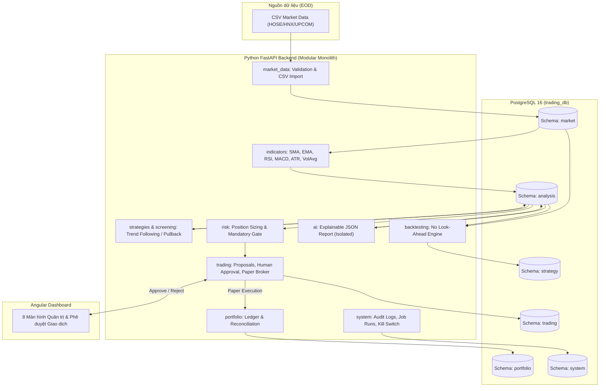
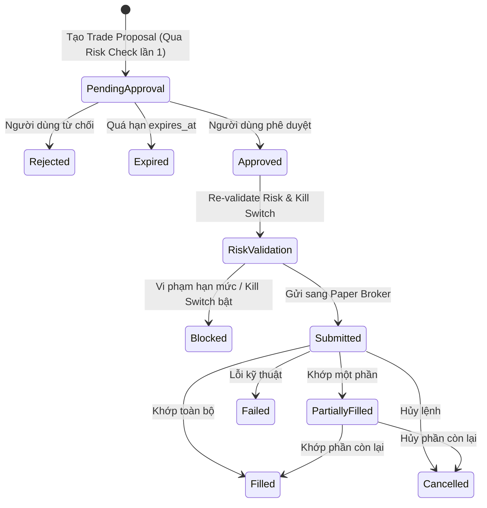

# DESIGN.md — Tài liệu Thiết kế Hệ thống & Giao diện

> **Ngày khởi tạo:** 2026-11-03  
> **Phiên bản:** 1.0 (MVP)  
> **Mục đích:** Mô tả chi tiết kiến trúc kỹ thuật, thiết kế cơ sở dữ liệu (6 schemas), luồng nghiệp vụ giao dịch an toàn và hệ thống thiết kế giao diện (UI/UX Design System) cho **Personal AI Trading Assistant**.

---

## 1. Kiến trúc Tổng thể (System Architecture)

Hệ thống được thiết kế theo mô hình **Python Modular Monolith + Angular Dashboard + PostgreSQL 16**, triển khai gọn nhẹ trong một Monorepo thông qua Docker Compose.

### Lý do lựa chọn kiến trúc:
- **Đồng nhất ngôn ngữ Backend (Python 3.12):** Loại bỏ độ trễ và chi phí duy trì cầu nối HTTP nội bộ giữa hai ngôn ngữ khác nhau, giúp chia sẻ trực tiếp các kiểu dữ liệu `Decimal`, Pydantic schemas và SQLAlchemy session.
- **Cô lập trách nhiệm bằng Module & Database Schema:** Dù nằm trong một codebase Python, dữ liệu được phân tách thành 6 schema PostgreSQL riêng biệt và module `ai` hoàn toàn không có dependency tới `trading` hay `paper_broker`.

---

## 2. Thiết kế Cơ sở Dữ liệu (6 PostgreSQL Schemas — 22 Bảng)

Toàn bộ giá trị tiền tệ và giá cổ phiếu sử dụng kiểu `NUMERIC(18,4)` hoặc `NUMERIC(18,2)`. Tất cả thời điểm sự kiện dùng `TIMESTAMPTZ` (UTC).

### 2.1. Schema `market` (Dữ liệu thị trường)
1. **`market.stocks`**: Danh mục mã cổ phiếu (`id`, `symbol` UNIQUE, `exchange`, `company_name`, `sector`, `is_active`, `created_at`).
2. **`market.data_sources`**: Nguồn cung cấp dữ liệu (`id`, `name`, `provider_type`, `license_notes`, `created_at`).
3. **`market.import_batches`**: Lịch sử lô import (`id`, `source_id`, `file_name`, `checksum`, `started_at`, `completed_at`, `status`, `rows_read`, `rows_inserted`, `rows_rejected`, `error_detail`).
4. **`market.daily_prices`**: Giá OHLCV theo ngày (`id`, `stock_id`, `source_id`, `import_batch_id`, `trading_date`, `open`, `high`, `low`, `close`, `adjusted_close`, `volume`, `created_at`).
   - *Constraints:* Unique `(stock_id, trading_date, source_id)`; `open, high, low, close > 0`; `high >= low`; `high >= open, close`; `low <= open, close`; `volume >= 0`.

### 2.2. Schema `analysis` (Phân tích kỹ thuật & AI)
5. **`analysis.analysis_runs`**: Lịch sử chạy phân tích (`id`, `run_type`, `started_at`, `completed_at`, `status`, `data_as_of`, `parameters`, `error_detail`).
6. **`analysis.technical_indicators`**: Chỉ báo kỹ thuật ngày (`id`, `stock_id`, `trading_date`, `ma20`, `ma50`, `ma200`, `ema20`, `ema50`, `rsi14`, `macd`, `macd_signal`, `macd_histogram`, `atr14`, `volume_avg20`, `calculation_version`).
   - *Constraints:* Unique `(stock_id, trading_date, calculation_version)`.
7. **`analysis.stock_signals`**: Tín hiệu giao dịch (`id`, `stock_id`, `strategy_version_id`, `analysis_run_id`, `trading_date`, `action`, `score`, `reference_price`, `stop_loss`, `reason` JSONB, `status`, `created_at`).
8. **`analysis.ai_reports`**: Báo cáo tổng hợp từ AI (`id`, `stock_id`, `signal_id`, `provider`, `model`, `prompt_version`, `input_snapshot` JSONB, `report` JSONB, `source_references` JSONB, `created_at`, `status`).

### 2.3. Schema `strategy` (Chiến lược & Backtest)
9. **`strategy.strategies`**: Định nghĩa chiến lược (`id`, `name`, `description`, `strategy_type`, `is_active`, `created_at`).
10. **`strategy.strategy_versions`**: Phiên bản tham số chiến lược (`id`, `strategy_id`, `version`, `configuration` JSONB, `code_version`, `created_at`). Unique `(strategy_id, version)`.
11. **`strategy.backtest_runs`**: Phiên chạy backtest (`id`, `strategy_version_id`, `start_date`, `end_date`, `initial_capital`, `fee_rate`, `tax_rate`, `slippage_bps`, `assumptions` JSONB, `metrics` JSONB, `status`, `created_at`).
12. **`strategy.backtest_trades`**: Chi tiết lệnh trong backtest (`id`, `backtest_run_id`, `stock_id`, `entry_date`, `exit_date`, `entry_price`, `exit_price`, `quantity`, `fees`, `taxes`, `pnl`, `exit_reason`).

### 2.4. Schema `trading` (Đề xuất, Phê duyệt & Lệnh Paper)
13. **`trading.trade_proposals`**: Đề xuất giao dịch (`id`, `signal_id`, `symbol`, `side`, `proposed_quantity`, `limit_price`, `stop_loss`, `estimated_cost`, `risk_amount`, `risk_check_result` JSONB, `status`, `expires_at`, `created_at`).
14. **`trading.approvals`**: Quyết định phê duyệt của con người (`id`, `proposal_id`, `decision`, `approved_by`, `comment`, `approved_at`).
15. **`trading.orders`**: Lệnh Paper (`id`, `proposal_id`, `broker_name` DEFAULT `'PAPER'`, `broker_order_id`, `client_order_id` UNIQUE, `symbol`, `side`, `order_type`, `quantity`, `filled_quantity`, `limit_price`, `average_fill_price`, `status`, `created_at`, `updated_at`).
16. **`trading.executions`**: Khớp lệnh chi tiết (`id`, `order_id`, `execution_id` UNIQUE, `quantity`, `price`, `fee`, `tax`, `executed_at`).

### 2.5. Schema `portfolio` (Danh mục & Sổ cái)
17. **`portfolio.accounts`**: Tài khoản tiền (`id`, `account_name`, `initial_capital`, `cash_balance`, `currency` DEFAULT `'VND'`, `account_type` DEFAULT `'PAPER'`, `created_at`).
18. **`portfolio.positions`**: Vị thế nắm giữ (`id`, `account_id`, `stock_id`, `quantity`, `available_quantity`, `average_cost`, `updated_at`). Unique `(account_id, stock_id)`.
19. **`portfolio.cash_transactions`**: Sổ cái biến động tiền mặt (`id`, `account_id`, `transaction_type`, `amount`, `reference_type`, `reference_id`, `description`, `created_at`).
20. **`portfolio.daily_snapshots`**: Chốt NAV cuối ngày (`id`, `account_id`, `snapshot_date`, `cash_balance`, `market_value`, `nav`, `unrealized_pnl`, `realized_pnl`). Unique `(account_id, snapshot_date)`.

### 2.6. Schema `system` (Hệ thống, Rủi ro & Audit)
21. **`system.risk_configs`**: Cấu hình hạn mức rủi ro (`id`, `name`, `configuration` JSONB, `is_active`, `created_at`).
22. **`system.job_runs`**: Lịch sử chạy job (`id`, `job_name`, `started_at`, `completed_at`, `status`, `records_processed`, `error_detail`).
23. **`system.audit_logs`**: Nhật ký kiểm toán (`id`, `actor`, `action`, `entity_type`, `entity_id`, `before_state` JSONB, `after_state` JSONB, `correlation_id`, `created_at`).
24. **`system.app_settings`**: Cấu hình ứng dụng (`key` PK, `value` JSONB, `updated_at`).

*(Lưu ý: Tổng cộng 24 bảng thuộc 6 schemas bao phủ toàn bộ đặc tả tại Mục 6 của Implementation Plan).*

---

## 3. Thiết kế Luồng Nghiệp vụ Trọng tâm

### 3.1. Vòng đời Lệnh (Order State Machine)

### 3.2. Nguyên tắc Kế toán & Đối soát Sổ cái (Ledger Accounting Rule)
- **Nguồn sự thật duy nhất (Source of Truth):** Bảng `trading.executions` (giao dịch cổ phiếu) và `portfolio.cash_transactions` (bút toán tiền mặt).
- **Dữ liệu tổng hợp (Projections):** `portfolio.positions`, `portfolio.accounts.cash_balance`, và `portfolio.daily_snapshots`.
- **Reconciliation Job:** Có khả năng tính toán lại từ đầu (rebuild) số dư tiền và khối lượng cổ phiếu từ lịch sử `cash_transactions` và `executions` để phát hiện mọi sai lệch.

---

## 4. Thiết kế Giao diện Người dùng (UI/UX Design System)

### 4.1. Triết lý Thiết kế
- **Rõ ràng & Chuyên nghiệp (Financial Clarity):** Tối ưu cho việc đọc bảng số liệu, biểu đồ và kiểm tra điều kiện rủi ro trước khi ra quyết định.
- **Nhận diện Môi trường Giả lập:** Luôn hiển thị thanh trạng thái nổi bật `PAPER TRADING MODE — SIMULATED CAPITAL` ở đầu trang để người dùng không bao giờ nhầm lẫn với giao dịch thật.

### 4.2. Bảng màu & Typography
- **Nền chính (Dark-first Financial Theme):**
  - Background Primary: `#0f172a` (Slate 900)
  - Surface / Card: `#1e293b` (Slate 800)
  - Border: `#334155` (Slate 700)
- **Màu ngữ nghĩa (Semantic Colors):**
  - Tăng giá / BUY / Healthy: `#10b981` (Emerald 500)
  - Giảm giá / SELL / Danger / Kill Switch: `#ef4444` (Red 500)
  - Cảnh báo / HOLD / Pending Approval: `#f59e0b` (Amber 500)
  - Thông tin / Primary Action: `#3b82f6` (Blue 500)
- **Typography:**
  - Chữ giao diện: `Inter`, system-ui, sans-serif.
  - Số liệu tài chính (Giá, Khối lượng, NAV, P&L): `JetBrains Mono` hoặc `monospace` kèm `font-variant-numeric: tabular-nums` để các chữ số thẳng hàng dọc.

### 4.3. Bố cục 8 Màn hình trên Angular Dashboard
1. **Overview (`/overview`):** Thẻ tổng hợp NAV, Tiền mặt, Giá trị cổ phiếu, P&L, trạng thái kết nối API/DB và danh sách vị thế hiện tại.
2. **Market (`/market`):** Danh sách mã cổ phiếu (HOSE/HNX/UPCOM), thông tin nguồn dữ liệu CSV, bảng giá OHLCV và chỉ báo kỹ thuật.
3. **Stock Scanner (`/scanner`):** Bộ lọc chiến lược (Trend Following, Pullback), kết quả quét và cảnh báo chất lượng dữ liệu.
4. **Signal Detail (`/signals`):** Chi tiết điểm số (`score`), snapshot chỉ báo, giá tham chiếu, mức cắt lỗ (`stop_loss`) và báo cáo giải thích từ AI kèm nguồn trích dẫn.
5. **Trade Approval (`/proposals`):** Màn hình trọng tâm nơi người dùng xem chi tiết rủi ro (`risk_amount`, tỷ trọng), thời hạn hiệu lực (`expires_at`) và nhấn **Approve** hoặc **Reject** kèm ghi chú.
6. **Orders (`/orders`):** Theo dõi trạng thái lệnh Paper (`Submitted`, `PartiallyFilled`, `Filled`, `Cancelled`) và lịch sử khớp lệnh (`executions`).
7. **Portfolio (`/portfolio`):** Cơ cấu danh mục, lịch sử sổ cái tiền mặt (`cash_transactions`) và biểu đồ biến động NAV theo ngày (`daily_snapshots`).
8. **Risk Settings (`/risk`):** Cấu hình giới hạn rủi ro (`max_position_percent`, `max_risk_per_trade_percent`, `max_daily_loss_percent`), nút **Kill Switch** khẩn cấp và lịch sử `audit_logs`.
